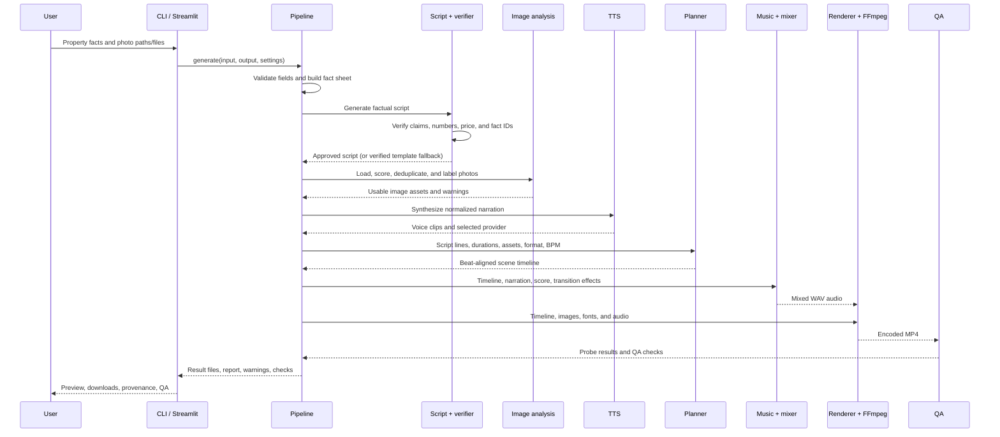

# ListingReel


ListingReel turns property facts and photos into a short, polished promotional video. It combines a web studio and command-line interface with a shared video-generation pipeline. The script is checked against the supplied facts, photos are assessed and matched using their filenames, narration and music are mixed, and the final MP4 is checked before delivery.

The project is designed to make repeatable property videos easier to create without manually editing every listing. It prioritizes factual accuracy, inspectable outputs, graceful handling of imperfect inputs, and a fast preview workflow.

## At a glance

- **Input:** property details in JSON or YAML, plus listing photos.
- **Output:** an H.264/AAC MP4, subtitles, a fact-grounded script, a QA report, a poster, and a storyboard.
- **Ways to use it:** a local Streamlit web studio or the `listingreel` CLI.
- **Default web workflow:** one click uses automatic narration, 540 × 960 preview rendering, and fast encoding.
- **Full-size CLI output:** vertical Reels, square, and landscape presets are available.
- **Optional AI:** an Anthropic-written script can be enabled; its output must pass the same grounding verifier as the built-in template.

## The problem and the solution

Property marketing usually requires someone to gather facts, choose photos, write a script, record or synthesize narration, edit scenes, add captions and music, export a video, and check the result. Repeating this process for each listing takes time. Hand-written or generated copy can also introduce unsupported claims.

ListingReel combines those steps in one pipeline:

1. Validate the listing and turn supplied details into a typed fact sheet.
2. Generate a short script from those facts and verify its claims and provenance.
3. Inspect photos, remove unusable or duplicate images, and match clearly named rooms to the relevant feature scenes.
4. Create narration, plan scenes to speech duration and musical beats, and compose a procedural soundtrack.
5. Render a captioned MP4 and inspect the finished file with automated QA.

The default script writer is a deterministic template. An optional LLM can propose alternative wording, but it does not bypass the verifier.

## Screens and outputs

The Streamlit app has these sidebar pages:

| Page | Purpose |
|---|---|
| **Overview** | Explains the workflow and shows the latest generated result. |
| **Studio** | Enter or edit property facts, upload photos, generate the video, and preview it. |
| **Results** | Review and download the MP4 and captions, and inspect QA results. |
| **Script & Provenance** | See each narration line and the facts that support it. |
| **Pipeline** | Review processing stages, timings, image scores, and the report. |
| **How it works** | Read an overview of the system and its grounding approach. |

The sidebar also contains the light/dark appearance toggle. The Studio uses automatic narration and fast preview settings; it does not expose voice-provider or encoding-speed selectors. CLI users can still explicitly choose a preset and narration provider.

### Generated files

| File | Contents |
|---|---|
| `video.mp4` | H.264 video with AAC audio, `yuv420p` pixel format, BT.709 color metadata, and fast-start metadata for playback. |
| `captions.srt` | Subtitle sidecar for the voice-over. |
| `script.json` | The fact sheet and final script, including fact IDs cited by each line. |
| `report.json` | Video metadata, timings, image scores, scene assignments, warnings, QA results, and a summary of component use. |
| `poster.jpg` | A representative frame from the rendered video. |
| `contact_sheet.jpg` | A storyboard assembled from frames sampled across scenes. |

The repository includes a sample listing, photos, and sample outputs under [`samples/`](samples/). These are examples; each new video is generated from the details and photos supplied for that run.

Outputs:


## Architecture

The CLI and web app call the same `pipeline.generate()` function. The pipeline connects typed input and script models to independent image, audio, planning, rendering, and QA stages.

```mermaid
flowchart LR
    User["Listing details + photos"] --> Interface{"CLI or Streamlit"}
    Interface --> Pipeline["pipeline.generate()"]
    Pipeline --> Intake["intake.py<br/>Parse, validate, normalize"]
    Intake --> Facts["FactSheet<br/>IDs and approved source facts"]
    Facts --> Script["scripting.py<br/>Template or optional LLM"]
    Script --> Verify{"Grounding verifier"}
    Verify -->|pass| Plan["planner.py<br/>Scene order, timing, photo match"]
    Verify -->|reject LLM wording| Template["Verified template fallback"]
    Template --> Plan
    Intake --> Imaging["imaging.py<br/>Decode, score, deduplicate"]
    Imaging --> Plan
    Plan --> TTS["tts.py<br/>Narration clips"]
    Plan --> Music["music.py<br/>Procedural score and transition SFX"]
    TTS --> Mixer["mixer.py<br/>Narration, ducking, music mix"]
    Music --> Mixer
    Plan --> Renderer["render.py + text_overlay.py<br/>Compose frames and captions"]
    Mixer --> Renderer
    Renderer --> FFmpeg["FFmpeg<br/>Encode MP4"]
    FFmpeg --> QA["qa.py<br/>Probe and validate output"]
    QA --> Outputs["MP4, SRT, script, report,<br/>poster, contact sheet"]
    Outputs --> Interface
```



### End-to-end generation pipeline



## Design and engineering approach

### Fact-grounded writing

`intake.py` creates a fact sheet with stable IDs for the property name, type, location, price, features, CTA, and contact details. `scripting.py` uses a deterministic template by default. Each line cites the IDs it relies on.

The verifier checks matters such as:

- Every line cites known fact IDs.
- Numbers and proper nouns are supported by the input.
- Claim words such as “luxury” or “near the metro” are not introduced unless supplied.
- The price, when included, matches the supplied price.
- Template wording stays within an approved set of connective words and listing facts.

An optional LLM-generated script goes through the same verifier. Invalid, unavailable, or unsupported LLM output falls back to the verified template and is recorded as a warning or script note.

### Image handling and scene matching

`imaging.py` handles image decoding and EXIF-aware orientation, estimates image quality using dimensions, sharpness, and exposure, detects near-duplicates with a perceptual hash, and estimates a focal point for camera motion.

`planner.py` uses recognizable filename terms such as `kitchen`, `balcony`, `bedroom`, `living_room`, `pool`, and `exterior` to match named feature scenes to images. It preserves supplied order for images that are not matched by a filename.

**Important limitation:** this is filename-based category matching, not an image-recognition model. ListingReel does not determine that an arbitrarily named photo depicts a kitchen or balcony. For better matching, use descriptive filenames (for example, `kitchen.jpg` and `balcony.jpg`) and make sure those files actually show the named rooms.

### Audio, timing, and rendering

- Speech normalization helps providers pronounce listing terms such as `2 BHK`, currency amounts, phone numbers, and square feet.
- Scene durations are based on narration clip lengths, then aligned to the configured beat grid.
- A duration governor tries to keep the edit within its target window by adding holds or dropping lower-priority feature scenes when needed.
- Music and transition effects are synthesized in code; narration and music are mixed with speech-driven ducking.
- NumPy and OpenCV compose frames with motion, transitions, text, and per-scene contrast scrims. Frames stream directly to FFmpeg rather than being stored as a frame sequence.

### Quality checks

The QA stage probes the **encoded video**, not just the render settings. It checks file presence, codec/pixel format, resolution, duration, audio-stream presence and audibility, and caption contrast. It writes results and warnings to `report.json`. Captions are checked against the WCAG AA contrast target during rendering.

## Technology stack

| Area | Technologies |
|---|---|
| Language and packaging | Python 3.10+, `pyproject.toml`, setuptools |
| Input models and validation | Pydantic v2, JSON, PyYAML |
| Image processing | OpenCV (headless), Pillow, NumPy |
| Audio and signal processing | NumPy, SciPy |
| Video and audio encoding / probing | FFmpeg and FFprobe (system tools) |
| Web application | Streamlit |
| Optional script generation | Anthropic Python SDK |
| Tests | pytest |

Most of the pipeline runs locally. Network access is needed only for cloud services you enable or that automatic narration selects, such as Edge TTS or ElevenLabs; optional Anthropic script generation also sends the fact sheet to Anthropic.

## Installation

### Requirements

- Python **3.10 or later**.
- FFmpeg and FFprobe on `PATH`.
- For the web app, install the `ui` extra.
- A TTS engine is optional, but recommended if you want spoken narration.

### Windows PowerShell

From the project directory:

```powershell
py -3.11 -m venv .venv
.\.venv\Scripts\Activate.ps1
python -m pip install --upgrade pip
python -m pip install -e ".[ui,dev]"
winget install --id Gyan.FFmpeg --exact
```

Open a new terminal after installing FFmpeg so the updated `PATH` is loaded. If script execution policy blocks activation, use the Python executable in `.venv\Scripts\python.exe` directly.

Check the environment and start the web app:

```powershell
listingreel doctor
streamlit run src/listingreel/app.py
```

The local address is printed by Streamlit, usually `http://localhost:8501`.

### macOS / Linux

Install Python 3.10+, FFmpeg, and FFprobe using your system package manager, then:

```bash
python3 -m venv .venv
source .venv/bin/activate
python -m pip install --upgrade pip
python -m pip install -e ".[ui,dev]"
listingreel doctor
streamlit run src/listingreel/app.py
```

The `doctor` command requires both `ffmpeg` and `ffprobe`; it also reports whether optional TTS, fonts, and Anthropic support are available.

## Quick start

### Generate a full-size vertical video with the CLI

```bash
listingreel generate samples/property.json --out out
```

The CLI defaults to the `reels` preset (1080 × 1920 at 30 fps) and automatic narration. Files are written into `out/`.

### Generate through the web studio

```bash
streamlit run src/listingreel/app.py
```

Open the printed local URL, select **Studio** in the sidebar, review the sample listing (or enter your own facts), add photos or keep the bundled sample photos selected, and click **Generate video**. The app uses a 540 × 960 preview with ultrafast encoding to reduce render time. When it finishes, the video, MP4 download, subtitle download, script provenance, and QA details are available in the studio or sidebar pages.

The fast preview is optimized for iteration and is lower resolution than the CLI's default full-size Reels output. Render time depends on CPU performance, photo sizes, audio provider, and network availability.

### Preview or validate a script without rendering

```bash
listingreel generate samples/property.json --preset preview --out out
listingreel generate samples/property.json --dry-run --out out
```

`--dry-run` writes the grounded script and a dry-run report without encoding a video. It does not require FFmpeg.

## Input format

JSON and YAML files are supported. The required fields are `name`, `location`, and `property_type`. Other fields are optional.

```json
{
  "name": "Skyline Residency",
  "location": "Whitefield, Bengaluru",
  "property_type": "2 BHK Apartment",
  "price": "₹85 Lakh",
  "features": [
    "1,050 sq ft carpet area",
    "Modular kitchen",
    "Private balcony",
    "Clubhouse and swimming pool"
  ],
  "cta": "Book your site visit today",
  "contact": "+91 98765 43210",
  "images": [
    "images/00_exterior.jpg",
    "images/02_living_room.jpg",
    "images/kitchen.jpg",
    "images/balcony.jpg"
  ]
}
```

### Field reference

| Field | Required | Notes |
|---|---:|---|
| `name` | Yes | Property name; 2–80 characters. |
| `location` | Yes | Location displayed in the hook; 2–100 characters. |
| `property_type` | Yes | For example, `2 BHK Apartment`; 2–60 characters. |
| `price` | No | String or number. Numeric rupee values are formatted using Indian digit grouping. |
| `currency` | No | Defaults to `₹`; used when formatting numeric prices. |
| `features` | No | List of feature strings; the default CLI maximum is five. |
| `cta` | No | Call to action; defaults to `Book your site visit today`. |
| `contact` | No | Optional phone number, email address, or contact text. |
| `images` | No | Paths relative to the property file, or absolute paths. |

Unknown input keys are rejected to catch misspellings. Features are cleaned, duplicate entries are removed, and overly long captions may be shortened with a warning.

The CLI can also take an image directory:

```bash
listingreel generate property.json --images ./property-photos --out out
```

The `--images` option overrides paths listed in the property file. Directory images are naturally sorted by filename. For semantic room matching, use filenames with descriptive terms such as `kitchen` and `balcony`. Arbitrary uploaded filenames cannot be visually classified.

## CLI reference

```text
listingreel doctor
listingreel generate PROPERTY [options]
```

Useful generation options:

| Option | Default | Description |
|---|---|---|
| `--out DIR` | `out` | Output folder. |
| `--images DIR` | — | Use images from a directory instead of the JSON image list. |
| `--preset NAME` | `reels` | `reels`, `square`, `landscape`, or `preview`. |
| `--bpm N` | `96` | Music tempo and beat-grid speed. |
| `--tts PROVIDER` | `auto` | `auto`, `elevenlabs`, `edge`, `kokoro`, `piper`, `espeak`, or `none`. |
| `--voice ID` | Provider default | Provider-specific voice identifier. |
| `--piper-model PATH` | — | Piper ONNX voice model file. |
| `--llm PROVIDER` | `none` | `anthropic` to request optional LLM script wording. |
| `--seed N` | Input-derived | Override the deterministic edit/music seed. |
| `--no-music` | — | Omit procedural music. |
| `--font PATH` | Auto-detected | TTF/OTF font for captions. |
| `--max-features N` | `5` | Maximum number of listing features to include. |
| `--dry-run` | — | Write and verify the script without rendering. |
| `--quiet` | — | Suppress progress output. |
| `--debug` | — | Show a traceback for unexpected errors. |

Examples:

```bash
# Fast draft
listingreel generate samples/property.json --preset preview --out out

# Square social post
listingreel generate samples/property.json --preset square --out out

# Landscape video
listingreel generate samples/property.json --preset landscape --out out

# No narration (captions and music remain)
listingreel generate samples/property.json --tts none --out out

# Use an Edge neural voice
listingreel generate samples/property.json --tts edge --voice en-IN-NeerjaNeural --out out

# Check just the grounded script
listingreel generate samples/property.json --dry-run --out out
```

Run `listingreel generate --help` for the installed CLI's full option list.

## Narration and API configuration

The web studio deliberately selects narration automatically. It does not show voice-provider settings or ask for an API key. The CLI allows an explicit provider via `--tts`.

### Automatic provider selection

`--tts auto` tries:

1. ElevenLabs if `ELEVENLABS_API_KEY` is configured.
2. Edge neural TTS.
3. Kokoro, when its package and model files are available.
4. Piper, when a Piper model is configured.
5. eSpeak.
6. Silent narration with captions if no engine is available.

If a selected cloud provider fails during synthesis, the pipeline records a warning and attempts a local eSpeak fallback; if eSpeak is unavailable, it uses silent narration. Provider selection and fallback are written to the output report.

### ElevenLabs

The project can use an ElevenLabs API key already set in the environment. It never needs to be written in the property file or source code.

Windows PowerShell:

```powershell
$env:ELEVENLABS_API_KEY = "your-key"
$env:ELEVENLABS_VOICE_ID = "your-voice-id" # optional
listingreel generate samples/property.json --tts auto --out out
```

macOS / Linux:

```bash
export ELEVENLABS_API_KEY="your-key"
export ELEVENLABS_VOICE_ID="your-voice-id" # optional
listingreel generate samples/property.json --tts auto --out out
```

Avoid committing keys to Git or sharing them in screenshots and logs. The default ElevenLabs voice ID is used when `ELEVENLABS_VOICE_ID` is unset.

### Edge TTS

Edge TTS does not require an API key, but it does require an internet connection and sends narration text to the provider. It is included with the `ui` extra.

```bash
listingreel generate samples/property.json --tts edge --voice en-IN-NeerjaNeural --out out
```

### Kokoro and Piper

Kokoro runs locally after installing `kokoro-onnx` and providing its ONNX model and voices file. The default file names are `kokoro-v1.0.onnx` and `voices-v1.0.bin`; `KOKORO_MODEL` and `KOKORO_VOICES` can override their paths.

Piper requires the `piper` executable and a compatible ONNX voice model:

```bash
listingreel generate samples/property.json --tts piper --piper-model path/to/voice.onnx --out out
```

Alternatively, set `LISTINGREEL_PIPER_MODEL` for automatic provider selection.

### Optional Anthropic script generation

The built-in template does not require an LLM or API key. To enable optional Anthropic wording:

```bash
python -m pip install -e ".[llm]"
```

Set `ANTHROPIC_API_KEY` in your environment, then run:

```bash
listingreel generate samples/property.json --llm anthropic --out out
```

The LLM receives the listing fact sheet. Its response is checked by the grounding verifier; rejected or unavailable output falls back to the template. As with all cloud services, use this option only if you are comfortable sending those listing facts to the provider.

## Photo acquisition

The repository includes a helper script for downloading photos from Pexels. It requires a Pexels API key, and downloaded photos are subject to Pexels' terms and each photographer's license/attribution requirements.

```powershell
$env:PEXELS_API_KEY = "your-pexels-key"
python scripts/fetch_photos.py --out samples/images
```

Use the images only in accordance with their source licensing terms. You can instead provide your own appropriately licensed photos.

## Repository layout

```text
.
├── docs/
│   └── DESIGN.md              # Design rationale and future roadmap
├── samples/
│   ├── property.json          # Example listing
│   ├── images/                # Example photos
│   └── output/                # Example generated artifacts
├── scripts/
│   └── fetch_photos.py        # Optional Pexels photo downloader
├── src/listingreel/
│   ├── app.py                 # Streamlit pages and studio
│   ├── cli.py                 # CLI commands and options
│   ├── config.py              # Presets and pipeline settings
│   ├── errors.py              # User-facing typed errors
│   ├── imaging.py             # Image loading, quality, dedupe, focal point
│   ├── intake.py              # Input validation and fact sheet
│   ├── mixer.py               # Narration/music/SFX mixing and ducking
│   ├── models.py              # Pydantic input, fact, script models
│   ├── music.py               # Procedural soundtrack and transition SFX
│   ├── pipeline.py            # Shared end-to-end orchestration
│   ├── planner.py             # Image matching and beat-synced scene timeline
│   ├── qa.py                  # MP4 checks, poster, storyboard
│   ├── render.py              # Frame compositor and FFmpeg encoder
│   ├── scripting.py           # Template, optional LLM, verifier
│   ├── text_overlay.py        # Caption layout and font selection
│   ├── tts.py                 # Speech normalization and TTS providers
│   └── ui/                    # Streamlit UI helpers
└── tests/
    ├── conftest.py
    ├── test_e2e.py
    ├── test_intake.py
    ├── test_media.py
    ├── test_scripting.py
    └── test_ui.py
```

## Development and testing

Install development and UI dependencies:

```bash
python -m pip install -e ".[ui,dev]"
```

Run the complete test suite:

```bash
python -m pytest -q
```

The tests cover input validation, fact and script grounding, optional LLM fallback, photo quality and duplicate handling, filename-based image matching, audio planning and mixing, UI navigation, and end-to-end video output. Tests that require FFmpeg are skipped when the system binary is unavailable.

The Makefile also provides:

```bash
make install
make doctor
make test
make ui
```

On Windows, run the underlying `python`, `listingreel`, and `streamlit` commands directly if `make` is not installed.

## Reliability, privacy, and limits

- **Unsupported claims:** The script verifier is intended to prevent unsourced facts and claims from reaching the video. Review the final script and video before publishing.
- **Photo labels:** Room matching depends on filenames, not a trained visual room classifier. Misnamed or ambiguous photos cannot be reliably identified from their pixels.
- **Photo quality:** Very small, blurry, corrupt, or duplicate images may be skipped. With few usable photos, some photos may be reused with tighter crops, and the report includes warnings.
- **Cropping:** Images are fit to the selected aspect ratio; wide photos in vertical output may lose some edges.
- **Narration:** Cloud TTS needs an internet connection and sends text to the selected provider. Local engines need their optional packages/models installed. If no narration engine works, the video can still use captions and music.
- **Performance:** Video composition is CPU-intensive. The web UI uses a low-resolution preview and fast encoder settings to reduce wait time; CLI full-resolution rendering takes longer and depends on the machine, input images, and audio provider.
- **External APIs:** Pexels downloads and optional Anthropic/ElevenLabs TTS require their respective credentials. Edge TTS does not require a key but uses a remote service.
- **Error handling:** Expected input and dependency failures are reported with actionable messages. Use `--debug` for unexpected CLI tracebacks.
- **License:** No `LICENSE` file is currently included. Unless a license is added, do not assume the source is available under a particular open-source license.

## Further design notes

[`docs/DESIGN.md`](docs/DESIGN.md) explains the design rationale and lists possible future work, including a queued API service, caching, localization, privacy processing, and expanded CI coverage. Roadmap ideas are not necessarily implemented.
